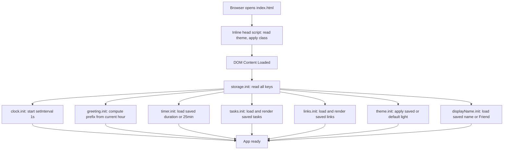

# Design Document: Todo Life Dashboard

## Overview

The **Todo Life Dashboard** is a zero-dependency, single-page web application that runs entirely in the browser. It combines five interactive widgets — a live clock/greeting, a Pomodoro focus timer, a to-do list, a quick-links launcher, and a light/dark theme toggle — persisting all user data in `localStorage`. The application must work when opened as a local `file://` URL with no server.

The design follows a single-file HTML approach (`index.html`) with one companion CSS file (`css/styles.css`) and one JavaScript file (`js/app.js`). No build step, bundler, or external library is required.

### Design Goals

- **Simplicity**: One HTML file, one CSS file, one JS file. Zero external dependencies.
- **Correctness**: Every widget's state lives in a single authoritative in-memory object; the DOM is always a reflection of that state.
- **Resilience**: `localStorage` failures degrade gracefully — the app keeps working in-session using in-memory state.
- **Theme correctness**: The theme is applied before first paint using an inline `<script>` in `<head>` to prevent flash of incorrect theme.

---

## Architecture

### High-Level Structure

```
index.html
  ├── <head>
  │     └── inline <script> — reads theme from localStorage, sets body class before paint
  ├── <body>
  │     ├── <header> card — clock, date, greeting, name editor, theme toggle
  │     ├── <main>
  │     │     ├── #timer-card   — focus timer widget
  │     │     └── #tasks-card   — to-do list widget
  │     └── <footer>
  │           └── #links-card  — quick links widget
  ├── css/styles.css    — CSS custom properties, layout, card styles, dark mode overrides
  └── js/app.js         — all application logic, grouped by module section
```

### Execution Flow



### Module Organization in `app.js`

`app.js` is structured as a set of immediately-invoked or `DOMContentLoaded`-scoped modules, each owning its own state and DOM references. No global variables leak between modules; they communicate through direct function calls where necessary (e.g. greeting update re-reads display name).

```
app.js
  ├── storage       — loadFromStorage(key), saveToStorage(key, value)
  ├── clock         — init(), tick(), formatTime(date), formatDate(date)
  ├── greeting      — init(), getPrefix(hour), render(name)
  ├── displayName   — init(), save(value), load(), getEffectiveName()
  ├── timer         — init(), start(), stop(), reset(), tick(), setDuration(min)
  ├── tasks         — init(), add(text), toggle(id), delete(id), edit(id, text), render()
  ├── links         — init(), add(name, url), remove(id), render()
  └── theme         — init(), toggle(), apply(theme)
```

---

## Components and Interfaces

### HTML Structure

```html
<!DOCTYPE html>
<html lang="en" data-theme="light">
<head>
  <meta charset="UTF-8" />
  <meta name="viewport" content="width=device-width, initial-scale=1.0" />
  <title>Todo Life Dashboard</title>
  <link rel="stylesheet" href="css/styles.css" />
  <!-- Flash-prevention: apply theme before paint -->
  <script>
    (function() {
      var t = localStorage.getItem('theme');
      if (t === 'dark') document.documentElement.setAttribute('data-theme', 'dark');
    })();
  </script>
</head>
<body>

  <!-- Error toast (hidden by default) -->
  <div id="error-toast" class="error-toast" aria-live="assertive" hidden></div>

  <!-- Theme toggle (fixed top-right) -->
  <button id="theme-toggle" class="theme-toggle" aria-label="Toggle theme">🌙</button>

  <!-- Header card: clock + greeting + name editor -->
  <header id="header-card" class="card">
    <div id="clock">00:00:00</div>
    <div id="date">Monday, January 1, 2025</div>
    <div id="greeting">Good morning, Friend!</div>
    <div class="name-editor">
      <input id="name-input" type="text" maxlength="50" placeholder="Your name…" />
      <button id="name-save-btn">Save</button>
      <span id="name-error" class="field-error" hidden></span>
      <span id="name-confirm" class="field-confirm" hidden></span>
    </div>
  </header>

  <main class="main-grid">

    <!-- Focus Timer card -->
    <section id="timer-card" class="card">
      <h2 class="card-title">Focus Timer</h2>
      <div id="timer-display">25:00</div>
      <div id="timer-complete" class="timer-complete" hidden>⏰ Time's up!</div>
      <div class="timer-duration-row">
        <label for="duration-input">Duration (min)</label>
        <input id="duration-input" type="number" min="1" max="180" value="25" />
        <span id="duration-error" class="field-error" hidden></span>
      </div>
      <div class="timer-controls">
        <button id="timer-start" class="btn btn-primary">Start</button>
        <button id="timer-stop"  class="btn btn-neutral">Stop</button>
        <button id="timer-reset" class="btn btn-neutral">Reset</button>
      </div>
    </section>

    <!-- Tasks card -->
    <section id="tasks-card" class="card">
      <h2 class="card-title">Tasks</h2>
      <div class="task-add-row">
        <input id="task-input" type="text" maxlength="100" placeholder="Add a task…" />
        <button id="task-add-btn" class="btn btn-primary">Add</button>
      </div>
      <span id="task-error" class="field-error" hidden></span>
      <ul id="task-list" aria-label="Task list"></ul>
    </section>

  </main>

  <!-- Quick Links card -->
  <footer>
    <section id="links-card" class="card">
      <h2 class="card-title">Quick Links</h2>
      <div class="link-add-row">
        <input id="link-name-input" type="text" maxlength="100" placeholder="Display name…" />
        <input id="link-url-input"  type="url"  placeholder="https://…" />
        <button id="link-add-btn" class="btn btn-primary">Add Link</button>
      </div>
      <span id="link-error" class="field-error" hidden></span>
      <div id="links-list" class="links-list" aria-label="Quick links"></div>
    </section>
  </footer>

  <script src="js/app.js"></script>
</body>
</html>
```

### JavaScript Module Interfaces

#### `storage`
```js
// Returns parsed value from localStorage, or null on missing/error
function loadFromStorage(key) { ... }

// Writes value as JSON; throws StorageError on failure (caller handles)
function saveToStorage(key, value) { ... }
```

#### `clock`
```js
function formatTime(date)  // → "HH:MM:SS"
function formatDate(date)  // → "Monday, July 14, 2025"
function tick()            // reads new Date(), updates #clock and #date
function init()            // calls tick() immediately, then setInterval(tick, 1000)
                           // also listens for document.visibilitychange to re-sync
```

#### `greeting`
```js
function getPrefix(hour)            // hour: 0–23 → "Good morning"|"Good afternoon"|"Good evening"|"Good night"
function formatGreeting(prefix, name) // → "${prefix}, ${name}!"
function init()                     // computes prefix once from current hour, renders greeting
function render(name)               // updates #greeting text
```

Hour ranges:
- `[5, 12)` → "Good morning"
- `[12, 17)` → "Good afternoon"
- `[17, 21)` → "Good evening"
- `[21, 24)` or `[0, 5)` → "Good night"

#### `displayName`
```js
function getEffectiveName()  // returns saved name or "Friend"
function load()              // reads from localStorage["displayName"]
function save(rawValue)      // trims; if empty → remove key, revert to Friend; if >50 → error; else save
function init()              // loads name, pre-fills #name-input, calls greeting.render()
```

#### `timer`
```js
// State object (private)
const timerState = {
  duration:   25,     // in minutes (the saved/configured duration)
  remaining:  1500,   // in seconds
  intervalId: null,
  isRunning:  false
};

function formatTimer(seconds) // → "MM:SS"
function start()              // no-op if isRunning; sets isRunning=true, starts interval
function stop()               // clears interval, sets isRunning=false, retains remaining
function reset()              // stop(), restore remaining to duration*60, clear completion
function setDuration(min)     // validates [1–180]; if running, stops first; updates state and display; saves
function tick()               // decrements remaining; if 0 → stop + show completion
function init()               // loads saved duration from storage or defaults to 25
```

#### `tasks`
```js
// State: array of task objects
let tasks = [];  // [{ id: number, text: string, completed: boolean }]

function validateTaskText(raw)        // trims; rejects empty/whitespace or >100 chars
function add(rawText)                 // validates, creates {id: Date.now(), text, completed:false}, pushes, saves, renders
function toggle(id)                   // flips completed for matching id, saves, renders
function deleteTask(id)               // filters out matching id, saves, renders
function editTask(id, rawNewText)     // validates, updates text, saves, renders
function saveTasks()                  // saveToStorage("tasks", tasks) — wrapped in try/catch, shows toast on error
function render()                     // clears #task-list, re-renders all tasks via renderTaskItem()
function renderTaskItem(task)         // returns <li> with checkbox, <span>, edit/delete buttons
function init()                       // loads tasks from storage, renders
```

Task item DOM structure (rendered):
```html
<li data-id="1234567890" class="task-item [completed]">
  <input type="checkbox" class="task-checkbox" [checked] />
  <span class="task-text [strikethrough]">Task text here</span>
  <button class="btn btn-icon edit-btn"   aria-label="Edit task">✏️</button>
  <button class="btn btn-danger delete-btn" aria-label="Delete task">🗑</button>
</li>
```

Edit mode replaces `<span>` with an `<input>` in place:
```html
<li data-id="..." class="task-item editing">
  <input type="checkbox" class="task-checkbox" />
  <input type="text" class="task-edit-input" value="Current text" />
  <button class="btn btn-primary save-edit-btn">Save</button>
  <button class="btn btn-neutral cancel-edit-btn">Cancel</button>
</li>
```

#### `links`
```js
let links = [];  // [{ id: number, name: string, url: string }]

function validateLink(name, url)   // name non-empty ≤100 chars; url starts with http:// or https://
function add(name, url)            // validates, creates {id: Date.now(), name, url}, pushes, saves, renders
function removeLink(id)            // filters out matching id, saves, renders
function saveLinks()               // saveToStorage("quickLinks", links) — wrapped in try/catch
function render()                  // clears #links-list, re-renders all link buttons
function renderLinkItem(link)      // returns a button + × badge element
function init()                    // loads from storage, renders
```

Link item DOM structure:
```html
<div class="link-item" data-id="...">
  <a href="..." target="_blank" rel="noopener noreferrer" class="btn btn-primary link-btn">
    Display Name
  </a>
  <button class="remove-link-btn" aria-label="Remove link">×</button>
</div>
```

#### `theme`
```js
function apply(theme)   // sets data-theme attribute on <html>, updates toggle button icon
function toggle()       // flips between "light" and "dark", saves to storage
function init()         // reads stored theme or defaults to "light", calls apply()
```

### Event Delegation

To avoid attaching per-item listeners that leak on re-render, task and link events are handled via delegation on the container:

```js
// Tasks
document.getElementById('task-list').addEventListener('click', (e) => {
  const li = e.target.closest('[data-id]');
  if (!li) return;
  const id = Number(li.dataset.id);
  if (e.target.matches('.delete-btn'))     tasks.deleteTask(id);
  if (e.target.matches('.task-checkbox'))  tasks.toggle(id);
  if (e.target.matches('.edit-btn'))       tasks.enterEditMode(id);
  if (e.target.matches('.save-edit-btn'))  tasks.confirmEdit(id);
  if (e.target.matches('.cancel-edit-btn')) tasks.cancelEdit(id);
});

// Links
document.getElementById('links-list').addEventListener('click', (e) => {
  const item = e.target.closest('[data-id]');
  if (!item) return;
  const id = Number(item.dataset.id);
  if (e.target.matches('.remove-link-btn')) links.removeLink(id);
});
```

---

## Data Models

### localStorage Schema

| Key               | Type            | Structure                                      | Default       |
|-------------------|-----------------|------------------------------------------------|---------------|
| `tasks`           | JSON array      | `[{id: number, text: string, completed: bool}]` | `[]`         |
| `quickLinks`      | JSON array      | `[{id: number, name: string, url: string}]`    | `[]`          |
| `displayName`     | JSON string     | `"Alex"`                                        | absent → "Friend" |
| `pomodoroDuration`| JSON integer    | `25`                                            | absent → 25   |
| `theme`           | JSON string     | `"light"` \| `"dark"`                          | absent → "light" |

### In-Memory State Objects

```js
// Timer state
const timerState = {
  duration:   25,     // configured minutes (integer 1–180)
  remaining:  1500,   // countdown seconds remaining
  intervalId: null,   // setInterval handle
  isRunning:  false
};

// Task item
{ id: 1720000000000, text: "Write design doc", completed: false }

// Link item
{ id: 1720000000001, name: "GitHub", url: "https://github.com" }
```

### CSS Custom Properties (Design Tokens)

```css
:root {
  --bg-gradient:      linear-gradient(135deg, #4c3fa0 0%, #7b6fd4 50%, #9b7ec8 100%);
  --card-bg:          #ffffff;
  --text-primary:     #111827;
  --text-secondary:   #6b7280;
  --accent-color:     #4f46e5;
  --accent-hover:     #4338ca;
  --danger-color:     #ef4444;
  --danger-hover:     #dc2626;
  --neutral-btn:      #e5e7eb;
  --neutral-btn-text: #374151;
  --border-color:     #e5e7eb;
  --card-shadow:      0 4px 16px rgba(0, 0, 0, 0.08);
  --card-radius:      14px;
}

[data-theme="dark"] {
  --card-bg:          #1f2937;
  --text-primary:     #f9fafb;
  --text-secondary:   #9ca3af;
  --neutral-btn:      #374151;
  --neutral-btn-text: #d1d5db;
  --border-color:     #374151;
}
```

---

## Correctness Properties

*A property is a characteristic or behavior that should hold true across all valid executions of a system — essentially, a formal statement about what the system should do. Properties serve as the bridge between human-readable specifications and machine-verifiable correctness guarantees.*

### Property 1: Time Format Correctness

*For any* valid `Date` object, `clock.formatTime(date)` SHALL return a string that matches the pattern `HH:MM:SS` where HH is zero-padded hours (00–23), MM is zero-padded minutes (00–59), and SS is zero-padded seconds (00–59).

**Validates: Requirements 1.1**

---

### Property 2: Date Format Completeness

*For any* valid `Date` object, `clock.formatDate(date)` SHALL return a string that contains a full weekday name, a full month name, a numeric day, and a four-digit year — all separated by commas and spaces as specified.

**Validates: Requirements 1.2**

---

### Property 3: Greeting Prefix Mapping

*For any* integer hour in `[0, 24)`, `greeting.getPrefix(hour)` SHALL return exactly:
- `"Good morning"` when `hour ∈ [5, 12)`
- `"Good afternoon"` when `hour ∈ [12, 17)`
- `"Good evening"` when `hour ∈ [17, 21)`
- `"Good night"` when `hour ∈ [0, 5)` or `hour ∈ [21, 24)`

and SHALL return no other string value for any valid input.

**Validates: Requirements 2.1, 2.2, 2.3, 2.4**

---

### Property 4: Greeting Format String

*For any* non-empty prefix string `p` and non-empty name string `n`, `greeting.formatGreeting(p, n)` SHALL return the string `"${p}, ${n}!"` exactly — preserving the original casing and content of both arguments.

**Validates: Requirements 2.5**

---

### Property 5: Display Name Round-Trip Persistence

*For any* non-empty, non-whitespace string `s` with `s.trim().length ≤ 50`, calling `displayName.save(s)` followed by `displayName.load()` SHALL return `s.trim()`, such that the stored and retrieved values are identical.

**Validates: Requirements 3.2, 3.4**

---

### Property 6: Timer Monotonic Decrease

*For any* timer state where `remaining > 0` and `isRunning === true`, each call to `timer.tick()` SHALL decrease `remaining` by exactly `1`. The value of `remaining` SHALL never increase while the timer is running, and SHALL never decrease below `0`.

**Validates: Requirements 4.2, 4.4, 4.5**

---

### Property 7: Timer Start Idempotence

*For any* timer state where `isRunning === true`, calling `timer.start()` SHALL leave `timerState` entirely unchanged — the same `intervalId`, `remaining`, `duration`, and `isRunning` values SHALL persist — so that exactly one countdown progresses at all times.

**Validates: Requirements 4.6**

---

### Property 8: Duration Validation

*For any* value `v`, `timer.validateDuration(v)` SHALL return an error result if and only if `v` is not an integer, or `v < 1`, or `v > 180`. For all integers `v` in `[1, 180]`, validation SHALL succeed.

**Validates: Requirements 5.5**

---

### Property 9: Task Text Validation

*For any* raw input string `s`:
- If `s.trim()` is empty (length 0), `tasks.validateTaskText(s)` SHALL return an error.
- If `s.trim().length > 100`, `tasks.validateTaskText(s)` SHALL return an error.
- If `s.trim().length` is in `[1, 100]`, `tasks.validateTaskText(s)` SHALL succeed and return the trimmed string.

**Validates: Requirements 6.3, 6.4**

---

### Property 10: Task Addition Grows List

*For any* task list of length `n` and any valid task text `s`, calling `tasks.add(s)` SHALL result in a task list of length `n + 1`, where the last element has `text === s.trim()` and `completed === false`.

**Validates: Requirements 6.2**

---

### Property 11: Task Render Completeness

*For any* task object `{id, text, completed}`, `tasks.renderTaskItem(task)` SHALL produce a DOM element containing a checkbox input, a text label displaying `task.text`, an edit button, and a delete button. When `completed === true`, the text label SHALL include the strikethrough CSS class.

**Validates: Requirements 6.7, 7.2**

---

### Property 12: Task Completion Toggle Round-Trip

*For any* task in the list, calling `tasks.toggle(id)` twice in succession SHALL return the task to its original `completed` state — the toggle operation is its own inverse.

**Validates: Requirements 7.1, 7.3**

---

### Property 13: List Item Deletion

*For any* array of items (tasks or links) and any `id` present in the array, calling the corresponding delete/remove function SHALL result in an array that contains no element with that `id`, and all other elements SHALL remain present and unchanged.

**Validates: Requirements 7.4, 10.2**

---

### Property 14: Storage Round-Trip

*For any* serializable value `v` (array, string, or integer), calling `storage.saveToStorage(key, v)` followed by `storage.loadFromStorage(key)` SHALL return a value structurally equal to `v` (deep equality). This must hold for all five storage keys.

**Validates: Requirements 12.1, 5.6, 6.2, 9.2, 11.3**

---

### Property 15: Theme Toggle Parity

*For any* initial theme `t₀ ∈ {"light", "dark"}` and any non-negative integer `n`, after calling `theme.toggle()` exactly `n` times, the active theme SHALL be:
- `t₀` if `n` is even
- the opposite of `t₀` if `n` is odd

**Validates: Requirements 11.1, 11.3**

---

### Property 16: Link URL Validation

*For any* string `url`, `links.validateLink(name, url)` SHALL reject the input (return an error) if `url` does not begin with `"http://"` or `"https://"`. For any `url` beginning with `"http://"` or `"https://"` paired with a non-empty `name`, validation SHALL succeed.

**Validates: Requirements 9.3, 9.4**

---

## Error Handling

### Storage Failures

All `localStorage` operations are wrapped in `try/catch`. On failure, the app:
1. Continues using the in-memory state (no data loss within the session).
2. Displays a transient error toast (`#error-toast`) with a descriptive message.
3. Hides the toast automatically after 4 seconds.

```js
function saveToStorage(key, value) {
  try {
    localStorage.setItem(key, JSON.stringify(value));
  } catch (e) {
    showToast(`Could not save changes: storage quota exceeded or unavailable.`);
  }
}

function loadFromStorage(key) {
  try {
    const raw = localStorage.getItem(key);
    return raw !== null ? JSON.parse(raw) : null;
  } catch (e) {
    return null;
  }
}
```

### Validation Errors

Each widget displays inline errors adjacent to its own input:

| Error site          | Element ID         | Trigger                                               |
|---------------------|--------------------|-------------------------------------------------------|
| Name input          | `#name-error`      | empty, whitespace, or >50-char submission             |
| Duration input      | `#duration-error`  | non-integer or out-of-range [1–180] input             |
| Task input          | `#task-error`      | empty/whitespace task, or text >100 chars             |
| Link inputs         | `#link-error`      | empty name, empty URL, or URL with invalid scheme     |

Errors are shown as `<span>` elements with `role="alert"` and are cleared when the user begins typing in the corresponding input.

### Timer Completion

When `remaining` reaches `0`:
1. `clearInterval(timerState.intervalId)` is called.
2. `timerState.isRunning` is set to `false`.
3. `#timer-complete` is un-hidden, displaying "⏰ Time's up!".
4. The `#timer-display` retains "00:00".

---

## Testing Strategy

### Dual Testing Approach

The testing strategy combines example-based unit tests for specific behaviors and property-based tests for universal correctness properties.

**Unit tests** target:
- Specific edge cases (e.g., boundary values at exactly 00, 05, 12, 17, 21 hours for greeting)
- Integration between modules (e.g., saving a task triggers localStorage write)
- Error scenarios (localStorage unavailability, quota exceeded)
- UI event interactions (double-click enters edit mode, Escape cancels edit)

**Property-based tests** target:
- The 16 correctness properties defined above, each run for a minimum of **100 randomized inputs**
- Pure functions: `formatTime`, `formatDate`, `getPrefix`, `formatGreeting`, `validateTaskText`, `validateDuration`, `validateLink`, `renderTaskItem`
- Storage round-trip for all five keys
- Timer monotonic decrease and idempotent start

### Property-Based Testing Library

Since this is a Vanilla JS project, use **[fast-check](https://github.com/dubzzz/fast-check)** for property-based tests, loaded via CDN or npm in a separate test environment (the app itself has zero dependencies).

Each property test is tagged with a comment referencing the design property:
```js
// Feature: todo-life-dashboard, Property 3: Greeting Prefix Mapping
fc.assert(
  fc.property(fc.integer({ min: 0, max: 23 }), (hour) => {
    const prefix = greeting.getPrefix(hour);
    if (hour >= 5  && hour < 12) return prefix === "Good morning";
    if (hour >= 12 && hour < 17) return prefix === "Good afternoon";
    if (hour >= 17 && hour < 21) return prefix === "Good evening";
    return prefix === "Good night";
  }),
  { numRuns: 100 }
);
```

### Test Configuration

- Minimum **100 iterations** per property test (fast-check default is 100; retain or increase).
- Pure logic functions are extracted from `app.js` as exported modules or tested via `window.*` in a test harness HTML page.
- Storage tests mock `localStorage` using a `Map`-backed stub to avoid real I/O.
- Timer tests mock `Date` and `setInterval`/`clearInterval` to control time deterministically.

### Test File Layout

```
tests/
  unit/
    clock.test.js        — formatTime, formatDate examples and edge cases
    greeting.test.js     — getPrefix boundary values, formatGreeting
    displayName.test.js  — save/load round-trip, empty/whitespace handling
    timer.test.js        — start/stop/reset, tick, setDuration, completion
    tasks.test.js        — add, toggle, delete, edit, validation
    links.test.js        — add, remove, URL validation
    storage.test.js      — saveToStorage/loadFromStorage round-trip, failure handling
    theme.test.js        — toggle parity, apply, persistence
  property/
    clock.prop.test.js   — P1, P2
    greeting.prop.test.js — P3, P4
    displayName.prop.test.js — P5
    timer.prop.test.js   — P6, P7, P8
    tasks.prop.test.js   — P9, P10, P11, P12, P13
    storage.prop.test.js — P14
    theme.prop.test.js   — P15
    links.prop.test.js   — P13 (links), P16
```
